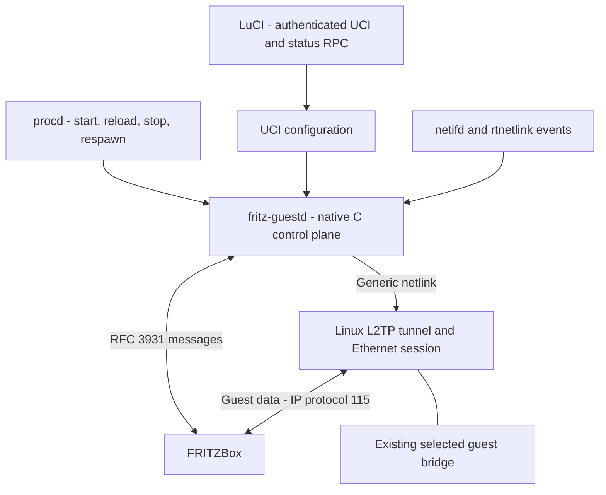
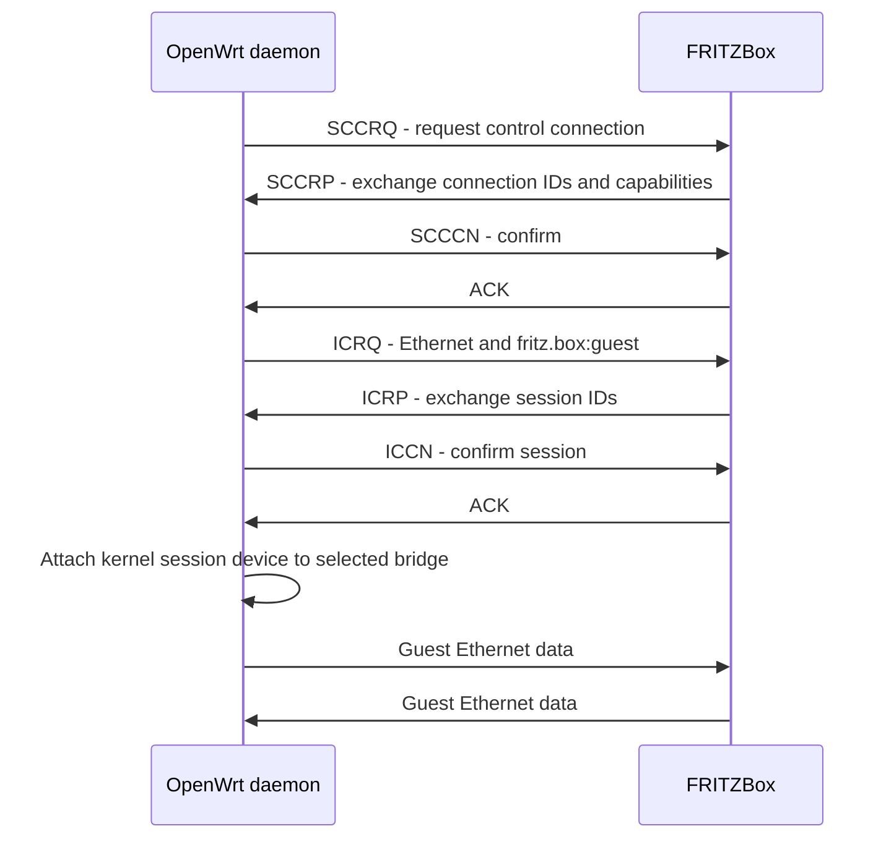
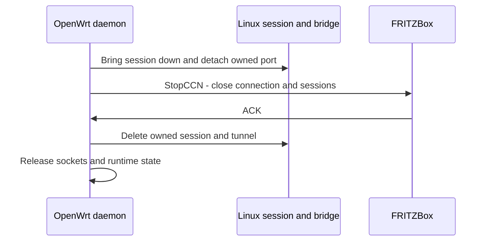
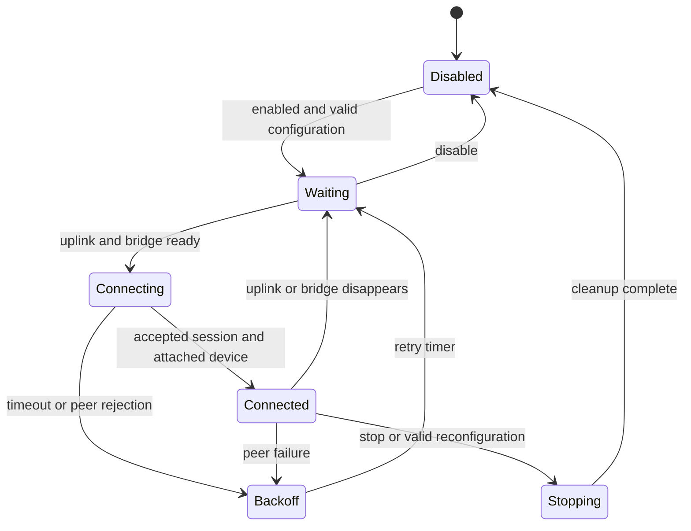

# fritz-guest: Design Specification

Version 1.0, 2026-10-10. Requirements use MUST, MUST NOT and SHOULD. They
describe the behaviour this project guarantees; changes to externally visible
contracts (UCI, ubus, LuCI) need a schema/version bump.

## 1. Purpose and introduction

fritz-guest is an OpenWrt package named `fritz-guest`, containing a daemon written in
C, and an optional package named `luci-app-fritz-guest`. The daemon negotiates
an Ethernet-over-L2TPv3 session to a FRITZ!Box guest service and attaches the
resulting Linux Ethernet interface to a **user-selected existing bridge**.
LuCI configures the same UCI state and displays daemon status.

Two address domains exist. The home LAN carries outer tunnel traffic, for
example `192.168.178.253 -> 192.168.178.1`. Guest clients send inner Ethernet/IP
traffic, for example `192.168.179.7 -> 192.168.179.1`. The guest addresses are
not tunnel endpoint addresses. The FRITZ!Box supplies guest DHCP, routing and
Internet policy. OpenWrt acts as a transparent guest-network extension.

| Term | Meaning |
|---|---|
| Control connection / tunnel | Stateful L2TPv3 relationship used to negotiate and maintain sessions |
| Session / pseudowire | Virtual Ethernet cable within a control connection |
| AVP | Attribute-Value Pair in a control message |
| Remote End ID | Service selector `fritz.box:guest`, not a password |
| Control plane | C daemon: negotiation, ACKs, timers, teardown |
| Data plane | Linux L2TP Ethernet modules: packet encapsulation/decapsulation |
| netifd | OpenWrt owner of configured network devices/interfaces |
| procd | OpenWrt service supervisor |
| UCI | Persistent OpenWrt configuration database |
| ubus / rpcd | Local IPC and authenticated LuCI RPC access |


This does NOT implement AVM Mesh membership, pairing, steering or Wi-Fi settings
synchronization. It is not L2TPv2/PPP, GRE, WireGuard or an encrypted VPN.

## 2. Evidence and scope

The protocol behaviour is documented in [docs/protocol.md](docs/protocol.md).
Interoperability tests used OpenWrt 25.12.5 on mediatek/filogic,
aarch64_cortex-a53; the FRITZ!Box model/firmware of those tests was not
recorded and MUST be recorded for every device acceptance run.

### Verified live behavior

* RFC 3931 control setup and `fritz.box:guest` Ethernet session succeeded
  without supplied Mesh credentials or shared secret.
* Guest DHCP offers/ACKs came from `192.168.179.1`.
* Two separate server sessions, 1001 and 1002, carried broadcast, unicast,
  ARP and tagged IPv4 UDP between guest endpoints in both directions.
* Both StopCCN messages were acknowledged. DHCP RELEASEs were sent.
* Two connections from the same outer source IP returned the same server
  Session ID, and the first stopped responding. Replacement by source IP is
  inferred, not an exhaustively established server rule.
* Initial traffic could consist only of spanning-tree BPDUs; later DHCP
  retries succeeded. Exact startup delay and cause remain unmeasured.

Separate tunnels MUST NOT be presented as guest-to-guest isolation. Home-LAN
hosts do not automatically see all unicast frames on a switched network, but
captured L2TP guest frames are unencrypted. WAN admission, guest-to-home
filtering, Wi-Fi station reachability, full-size traffic and IPv6 policy were
not established by those tests.

### Scope

MUST support one fixed IPv4 server, one control connection and one Ethernet
guest session, attached to one existing bridge. Outer IPv6, UPnP discovery,
server mode, Cisco dialect, multiple simultaneous configurations and LuCI
bridge creation are out of scope. Inner IPv6 Ethernet traffic MUST pass
transparently; guest IPv6 service depends on FRITZ!Box configuration.

## 3. Repository layout

```text
src/                              portable C daemon implementation
tests/                            focused protocol/lifecycle tests
docs/                             protocol notes
tools/                            diagnostic probe (not installed)
justfile                          SDK download, package build and test recipes
package/fritz-guest/Makefile       target-specific native package
package/fritz-guest/files/         UCI defaults and procd init script
package/luci-app-fritz-guest/      optional architecture-independent UI package
```

The router runtime MUST NOT need Python, vendor libraries or a compiler. The
implementation is written from RFC 3931/4719 and black-box interoperability
tests; the Python probe is a diagnostic tool, not a runtime component.

## 4. UCI contract

File: `/etc/config/fritz-guest`. Exactly one named `connection` section, `guest`.
MUST fail validation if unsupported enabled sections would cause additional
sessions; do not silently start multiple tunnels from one outer address.

```uci
config connection 'guest'
    option enabled '0'
    option server '192.168.178.1'
    option uplink 'lan'
    option bridge ''
    option mtu '1500'
    option hello_interval '30'
    option retry_max '5'
    option reconnect_max '60'
```

| Option | Contract |
|---|---|
| enabled | Boolean 0/1; default 0. Disabled means no socket, tunnel or guest bridge port |
| server | Required when enabled; unicast IPv4 literal, not unspecified, multicast or broadcast; no DNS resolution |
| uplink | Logical `network.interface` name; default lan. Resolve current L3 device/source IPv4 through netifd |
| bridge | Required when enabled; exact existing UCI `config device` name with type bridge, e.g. br-guest. Not a logical interface or raw physical port |
| mtu | Guest L3 MTU, integer 1280..1500; default 1500 |
| hello_interval | Idle keepalive seconds, integer 10..300; default 30; local implementation setting, not a FRITZ!OS value |
| retry_max | Retransmissions after first send, integer 1..10; default 5 |
| reconnect_max | Maximum reconnect backoff seconds, integer 10..300; default 60 |

The selector MUST store a device name rather than a numeric ifindex. Daemon
MUST re-resolve ifindex after device recreation. Unknown options may be ignored
for forward compatibility, but known options with invalid values MUST reject
the proposed configuration. Bound name lengths and validate strings through
structured APIs; never interpolate user values into shell commands.

UCI is the single persistent source of truth. Runtime status MUST live in
memory/ubus, not a second editable configuration file. Reload MUST validate
the whole candidate before disrupting a working connection. Malformed reload
keeps the previous active configuration and exposes a reload error; an explicit
valid disable or bridge change tears down the old session.

### Example network setup (operator-owned)

```uci
config device
    option name 'br-guest'
    option type 'bridge'
    option bridge_empty '1'

config interface 'guest_extension'
    option device 'br-guest'
    option proto 'none'
```

Assign a guest Wi-Fi interface to `guest_extension` in normal Wireless settings,
or add dedicated LAN ports to br-guest. Do not put the transport uplink in
br-guest. Hardware-specific ports, DHCP pool, firewall zones and station
isolation remain explicit operator decisions; no package defaults may move
ports or overwrite `/etc/config/network`, wireless, DHCP or firewall files.

## 5. Bridge and uplink lifecycle

MUST verify both persistent UCI type bridge and the live rtnetlink kind bridge.
Reject non-bridge targets, the resolved outer transport device/its bridge
master, a bridge containing that transport device, and any combination that
would forward ordinary home traffic into the guest network. Configuration
must use a dedicated guest bridge; detection of local DHCP service or guest
management exposure MUST be documented as an operator preflight warning,
not silently repaired by this package.

Resolve an available source IPv4 belonging to the configured uplink. A server
route must use that uplink; reject a route through the guest bridge or a loop
through the session device. Require direct LAN connectivity for release 1;
do not claim NAT traversal. Loss/change of source IP or transport device
MUST detach/tear down and renegotiate with new IDs after readiness returns.

Subscribe to netifd/ubus events and rtnetlink link/address changes. A configured
but absent bridge or uplink means `waiting`, not attachment to another bridge.
Bridge removal/recreation MUST cause detachment and fresh ifindex resolution.

**Ownership split:** netifd owns the existing bridge and its configured ports;
the daemon owns only its tunnel, session and `fritzguest0` device. Dynamic
membership uses netifd's `add_device`/`remove_device` on the
logical interface that owns the bridge, so it survives network reload; direct
rtnetlink detachment is only a fallback when netifd is unreachable. Stale
membership of `fritzguest0` is dropped at daemon start. No persistent tunnel
entry may be written into the bridge's UCI port list.

Create the session device down, set MTU, establish ownership, attach it to the
selected bridge only when the protocol permits traffic, then bring it up.
On failure/stop, bring it down and detach before deleting it. Do not delete
or reconfigure the selected bridge, its other ports, or unrelated L2TP objects.
If `fritzguest0` already exists and ownership is not provable, fail safely.
Crash recovery may only reconcile objects recorded as this daemon's own;
do not remove an arbitrary object merely because its name or IDs match.

## 6. Native C architecture

C11, musl-compatible, event-driven single process in the foreground under
procd. Prefer `libubox`/uloop, `libubus`, `libuci` and a maintained netlink
library such as `libmnl`. Use upstream Linux L2TP support for packet forwarding.
No shell-command based packet parser, Python daemon, C++ AVM ABI dependency,
or polling loop that blocks network events.



Recommended logical modules: configuration/validation, control codec/reliable
transport, connection/session FSM, Linux tunnel/netlink operations, network
event handling, ubus status and main/service lifecycle. This is guidance, not
a requirement to create one file per module. No unnecessary plugin framework.

Install `/usr/sbin/fritz-guestd`. CLI: `--config <uci-package>` (default
fritz-guest), `--check-config` (validate without side effects), `--version`.
Use SIGTERM/SIGINT for bounded graceful shutdown and SIGHUP for validated
reload. Log to syslog/logread with rate limiting; debug is opt-in and MUST NOT
dump guest payloads by default. Do not write counters/keepalive state to flash.

## 7. Wire protocol requirements

Fixed server over **IP protocol 115**, NOT UDP and NOT TCP port 115. RFC 3931
and RFC 4719 govern control framing and Ethernet payloads. Control packets
carry a zero 32-bit Session ID followed by the v3 control header (T/L/S set,
version 3, length, recipient connection ID, Ns, Nr, AVPs). Length starts at
T, excluding the zero Session ID. Data uses the receiver's nonzero session ID.



ACKs may be explicit or piggybacked; this diagram is logical, not a required
instruction-level ordering. The default RFC dialect was live-tested; Cisco
mode is not required.

### Required outbound AVPs

| Message | Mandatory message content |
|---|---|
| SCCRQ (1) | Message Type, Host Name, Router ID, Assigned Control Connection ID, PW Capabilities List including Ethernet 5 |
| SCCCN (3) | Message Type |
| ICRQ (10) | Message Type, Local Session ID, Remote Session ID 0, Serial Number, PW Type 5, Remote End ID fritz.box:guest, Circuit Status active/new |
| ICCN (12) | Message Type, Local Session ID, Remote Session ID |
| HELLO (6) | Message Type |
| CDN (14) | Message Type, Result Code, Local Session ID, Remote Session ID |
| StopCCN (4) | Message Type, Result Code; include Assigned Connection ID when required by RFC |
| ACK (20) | Explicit Message Type or unauthenticated ZLB form; MUST NOT advance Ns |

Advertise Receive Window Size 1 initially; one outstanding message is adequate
for this client. Request default L2-specific sublayer type 1 and data sequencing
0 in ICRQ. Circuit Status active/new is 0x0003. Validate mandatory SCCRP/ICRP
fields, Ethernet capability, nonzero IDs, peer status and matching Remote
Session ID. A Router ID is an identifier, not inherently an IPv4 address.

Choose nonzero connection/session IDs with OS randomness and check local
collisions. Update Nr in retransmissions without advancing Ns. Implement
16-bit wraparound, duplicate/out-of-order processing, ACK sanity checking,
bounded send queues and peer window handling. Retransmit initially after 1s,
double up to 8s, limit by retry_max. All deadlines use monotonic time. Jitter
reconnect attempts: 1s, 2s, 4s, then exponential up to reconnect_max; reset after
60s of stable session service. These are our defaults, not FRITZ!OS timers.

Implement periodic idle HELLO after hello_interval; lost HELLO is handled
through reliable delivery and ultimately teardown/reconnect. Handle peer
HELLO, ACK, CDN, StopCCN and SLI. Peer inactive Circuit Status stops forwarding;
reactivation must be explicit. Reject unsupported session requests cleanly
rather than establishing a second session.

No secret/authentication is required for the observed server. If a peer
requires authentication or a feature the implementation cannot honor, expose
`unsupported_peer` and tear down; do not pretend to validate a digest or hide
an AVP. Unknown mandatory AVPs cause protocol-correct CDN/StopCCN; unknown
optional AVPs may be ignored. Validate sizes, hidden bits, vendor IDs, lengths,
duplicates and message-state legality before consuming values. Reject malformed
packets without out-of-bounds reads or unbounded memory allocation. Drop traffic
from wrong source/address/connection/session contexts.

Assigned cookies and nonzero AVM offset (vendor 872, attribute 1) were not
needed live. Release 1 MUST explicitly reject nonzero cookies, non-default
sublayers, required sequencing and nonzero AVM offsets unless deliberately
implemented and tested. Never silently misinterpret their data-plane layout.
Use RFC-required sublayer negotiation semantics; omission must not casually
be treated as confirmation of type 1.

## 8. Kernel setup, data and teardown

Declare dependencies `kmod-l2tp-ip`, `kmod-l2tp-eth` (pull `kmod-l2tp`). Use
generic netlink family l2tp with version 3/IP encapsulation and negotiated
local/peer connection IDs. For a **managed** tunnel use an upstream-compatible
AF_INET/SOCK_DGRAM/IPPROTO_L2TP socket and sockaddr_l2tpip connection IDs,
bind/connect as required by the target kernel, and supply its FD to the
kernel API. The kernel adds and strips the zero control Session ID on this
socket; `tests/kernel-test.c` verifies that framing. The raw socket used by
the Python probe is not a valid FD for a managed kernel tunnel.
Do not substitute an unmanaged static `ip l2tp add` tunnel without explaining
and testing its control/socket and cleanup semantics.

Kernel session: negotiated local/peer Session IDs, PW Ethernet 5, default
four-byte L2-specific sublayer, no cookies or sequencing, `fritzguest0`,
configured MTU. Frame data: recipient Session ID (4), default sublayer (4),
guest Ethernet header (14) and payload; no FCS. The ordinary 20-byte outer
IPv4 header gives 42 bytes beyond the guest IP payload, so 1500-byte guest
IP traffic needs 1542-byte outer packets, or fragmentation/another tested MTU
strategy. MUST test large packets/PMTU, including UDP and TCP rather than
assuming TCP MSS changes fix all traffic. No automatic underlay MTU changes.



CDN closes a session; StopCCN closes all sessions in a connection. Either peer
can initiate; CDN-before-StopCCN is not mandatory. On local graceful stop,
detach traffic immediately, retain control reliability state until ACK or
configured retry exhaustion, then release remaining resources. Shutdown bound
with retry_max 5 is 31s (1+2+4+8+8+8); configure procd termination timeout at
least 40s. If killed/crashed, managed socket lifetime plus scoped startup
reconciliation MUST avoid orphan interfaces and accidental adoption of foreign
objects. Peer timeout, restart and missing bridge must fail closed.

Kernel/device up and protocol established are NOT proof that DHCP or Internet
access works. Startup may require bridge forwarding delay. Do not disable
operator-configured STP globally to mask that delay.

## 9. Runtime states and service behavior



Invalid startup configuration is `error`, not an endless crash/respawn loop.
Transient dependencies are `waiting`; retryable network failures are `backoff`.
Connected means control session accepted and attached/up, not verified DHCP.
Use reason codes in status rather than requiring users to parse logs.

Install `/etc/init.d/fritz-guest` using procd with UCI reload triggers and ubus
interface events. Default configuration/service MUST make no connection until
explicitly enabled. Daemon may remain running in disabled state to provide
status/configuration validation, but it MUST hold no tunnel-related resources.
Changing enabled through LuCI Save & Apply MUST start/stop connectivity without
manual SSH, including when the service was initially stopped. The backend
integration must supply this apply path; the UI alone is not enough.

Disable, stop/restart, invalid reload, bridge switch, network reload and uplink
renewal MUST be idempotent. procd respawn covers process failure, not normal
reconnect; the daemon itself handles reconnect without process churn.

## 10. ubus API and least-privilege RPC

Daemon registers object `fritz-guest`, method `status`, read-only and without
arguments. Supported local call: `ubus call fritz-guest status '{}'`.
Return structured data; no shell execution helpers for user input.

```json
{
  "schema_version": 1,
  "state": "connected",
  "reason": "",
  "last_error": "",
  "reload_error": "",
  "enabled": true,
  "server": "192.168.178.1",
  "uplink": "lan",
  "local_address": "192.168.178.253",
  "bridge": "br-guest",
  "device": "fritzguest0",
  "control_id": 12345,
  "peer_control_id": 54321,
  "session_id": 12346,
  "peer_session_id": 1001,
  "mtu": 1500,
  "connected_seconds": 120,
  "reconnects": 0,
  "rx_bytes": "123456",
  "tx_bytes": "654321"
}
```

States: disabled, waiting, connecting, connected, backoff, stopping, error.
Reasons include uplink_missing, bridge_missing, invalid_config, bridge_unsafe,
peer_rejected, timeout, unsupported_peer, kernel_error, bridge_attach_error.
Absent IDs/timing use null; missing devices/addresses use empty strings.
Counters are decimal strings to avoid JavaScript's 53-bit integer precision
limit. Counter availability must be honest: use null when not yet measurable.
Expose effective running state; a separately changed UCI file is not proof
the daemon has applied it. Status failures/disconnected ubus MUST be displayed
as unavailable, never as an empty successful connection.

RPC ACL permits read of `fritz-guest.status`, network interface/device status,
and UCI fritz-guest/network; write ONLY UCI fritz-guest. No blanket file/exec,
network UCI writes, unrestricted service methods or arbitrary ubus access.
Use the normal LuCI UCI apply mechanism. If a service control method is needed
for apply on the supported release, grant only its narrowly defined API and
document why. Backend local ubus and rpcd authentication permissions are
different; remote LuCI calls must respect ACL/session permissions.

## 11. LuCI application

Package `luci-app-fritz-guest`, depends on fritz-guest and luci-base;
architecture-independent native LuCI JavaScript, not legacy Lua CBI or a
separate SPA. Menu: Services -> FRITZ! Guest Network. Use standard LuCI form,
network and polling APIs and existing visual conventions.

One overview page MUST include enabled, IPv4 server, uplink selector, bridge
selector and advanced numeric settings (MTU/timers). Show **only bridges**
defined as UCI config device/type bridge for selection. Display clear labels
that distinguish logical uplink from device bridge. Warn/reject target equal
to uplink device when detectable; backend repeats safety validation.
If a saved bridge has vanished, display that configured value as unavailable
rather than silently choosing another. Hidden incompatible devices MUST NOT
be selected through stale values or crafted RPC/config requests.

Poll read-only status at 5s while the view is active. Show state/reason/error,
outer local/server address, configured/active bridge and tunnel device,
negotiated IDs, connected duration, counters and reconnect count. A missing
daemon, denied RPC or load error must not block editing disabled configuration;
show unavailable status. Render peer/config strings as text, not raw HTML.
Save, Save & Apply and Reset use normal LuCI behavior; avoid duplicate storage
and bespoke state. Translation-ready text via `_()`.

Read-only sessions MUST see the page without being able to save. No fake
live-status values. LuCI is optional: the daemon must be fully operable via
UCI and init/ubus without it.

## 12. Packaging, security and performance

Baseline: OpenWrt 25.12.x SDK matching target mediatek/filogic, musl,
aarch64_cortex-a53. Native daemon package MUST be target architecture, not
PKGARCH all; LuCI is all. Standard cross-build and staged install with normal
OpenWrt hardening flags. Declare the project license and the actual upstream
library licenses and provide their required notices.

Backend dependencies MUST include required kernel modules and actual linked
libraries; no Python or iputils dependency. `ip-full` is diagnostic-only if
all runtime operations are structured C APIs. Declare `/etc/config/fritz-guest`
a conffile; retain user UCI settings on package upgrade/sysupgrade. Runtime
IDs, sockets and counters MUST NOT persist across reboot. Document install,
upgrade/uninstall, logs, firewall requirements and safe recovery.

Need CAP_NET_ADMIN for kernel/bridge actions; CAP_NET_RAW if the selected
control socket design requires it. Running as root under procd is acceptable
for release 1 if justified; avoid privilege escalation helpers and broad RPC.
Allow outer protocol 115 only to/from the configured server on the selected
transport as necessary, including fragmentation behavior. Do not rewrite the
firewall or add a global ACCEPT rule automatically.

No local guest DHCP, NAT, address assignment, DNS server, packet inspection or
payload logging. Ethernet source/destination MACs and broadcasts must remain
transparent. Local OpenWrt IPv4/IPv6 management services and bridge forwarding
policy need an explicit operator firewall plan; absence of a bridge IPv4
address does not alone eliminate IPv6 link-local/local service exposure.

Keep idle work event-driven and memory bounded. Control traffic is low volume;
kernel data forwarding must not traverse a userspace per-frame loop. Report
idle CPU/RSS and transfer throughput on the reference device, without claiming
a hardware-independent throughput target. No recurring flash writes.

## 13. Right-sized tests and acceptance

Use one focused host test binary for codec/reliable transport/state transitions,
plus one disposable Linux namespace integration harness where feasible and a
short manual real-device checklist. Do not require a large CI/farm framework.
Add regression tests for actual defects found. Network tests MUST clean up
their own objects even when failing; test only on networks you administer.

### Automated gates

1. Compile with warnings enabled; host ASan/UBSan tests pass for malformed AVP
   lengths, wrong vendor/mandatory bits, incorrect IDs, truncated headers and
   hidden/unsupported fields. Validate outgoing bytes against RFC and the
   live-tested probe (not byte-identical randomness).
2. Simulated peer exercises SCCRQ through ICCN, explicit/piggyback ACK,
   retransmission with updated Nr, duplicate/out-of-order packets, sequence
   wrap, HELLO loss, peer CDN/StopCCN/SLI and bounded cleanup.
3. Kernel integration proves managed socket/netlink setup, Ethernet header
   preservation, bridge attachment, detach/delete, wrong bridge rejection,
   no effects on foreign objects and no local DHCP/NAT.
4. Validate both package Makefiles/install manifests, UCI defaults, JSON ACL/menu
   files, LuCI syntax, status contract and SDK build of both artifacts.

### Manual device acceptance

| ID | Required evidence |
|---|---|
| A1 | Fresh install remains disconnected and does not change network/wireless/firewall/DHCP UCI |
| A2 | UCI selects br-guest; dedicated guest SSID/port gets real FRITZBox DHCP lease through kernel session |
| A3 | Guest client uses intended FRITZBox gateway/DNS; Internet TCP/UDP and full-size packet behavior recorded |
| A4 | DHCP/ARP/IPv4 and inner IPv6 transparency checked; IPv6 service unavailable is reported as environment limitation, not silent claimed success |
| A5 | Home-LAN access isolation and local management protection explicitly checked with operator firewall policy; guest-to-guest behavior documented |
| A6 | Uplink loss/address renewal, FRITZBox restart, network reload and selected bridge recreation recover without duplicate tunnels or wrong-port attachment |
| A7 | Valid bridge change moves only owned device; invalid reload retains active config; unsafe home bridge rejected |
| A8 | Ten start/stop/reload cycles leave no owned objects or leaked sockets/processes; foreign bridge ports/L2TP objects unchanged |
| A9 | LuCI loads, bridges only selectable, Save & Apply works from stopped/disabled state, status unavailable handled, least-privilege read-only/write sessions tested |
| A10 | Package upgrade preserves UCI; uninstall/stop does not delete user bridge; clean rebuild works from documented SDK commands |

Record model/FRITZ!OS, OpenWrt build/kernel, topology, configuration, commands,
expected/actual outcomes and unresolved limits. No acceptance claim solely from
Python probe success: a real guest station behind the kernel interface and
selected bridge is mandatory.

## References

* [Protocol notes](docs/protocol.md) and [diagnostic probe](tools/fritz_guest_probe.py)
* [RFC 3931](https://www.rfc-editor.org/rfc/rfc3931.html)
* [RFC 4719](https://www.rfc-editor.org/rfc/rfc4719.html)
* [Linux L2TP](https://docs.kernel.org/networking/l2tp.html)
* [OpenWrt kernel modules](https://github.com/openwrt/openwrt/blob/main/package/kernel/linux/modules/netsupport.mk)
* [Two-package layout reference](https://github.com/nanosonde/ipv4-passthrough/tree/main)