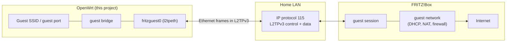
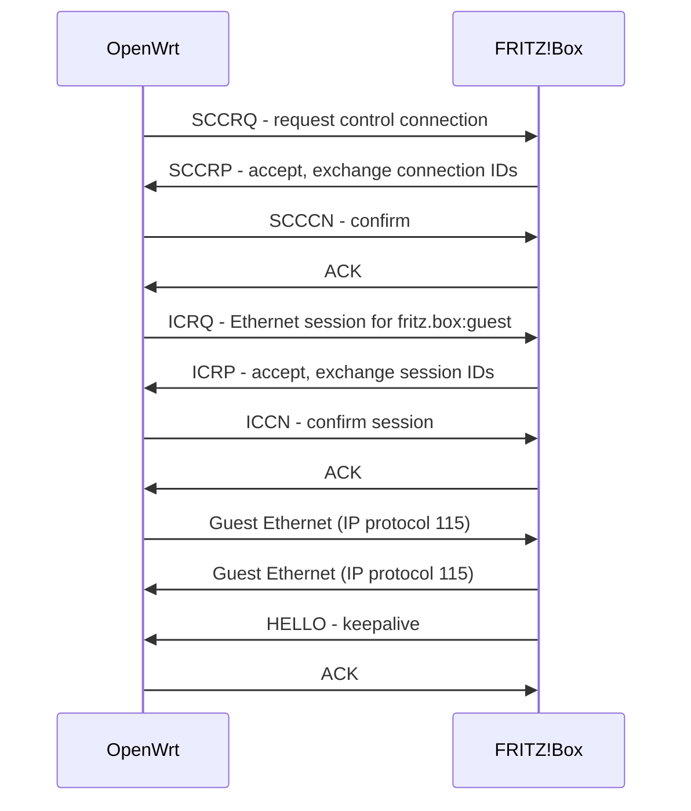
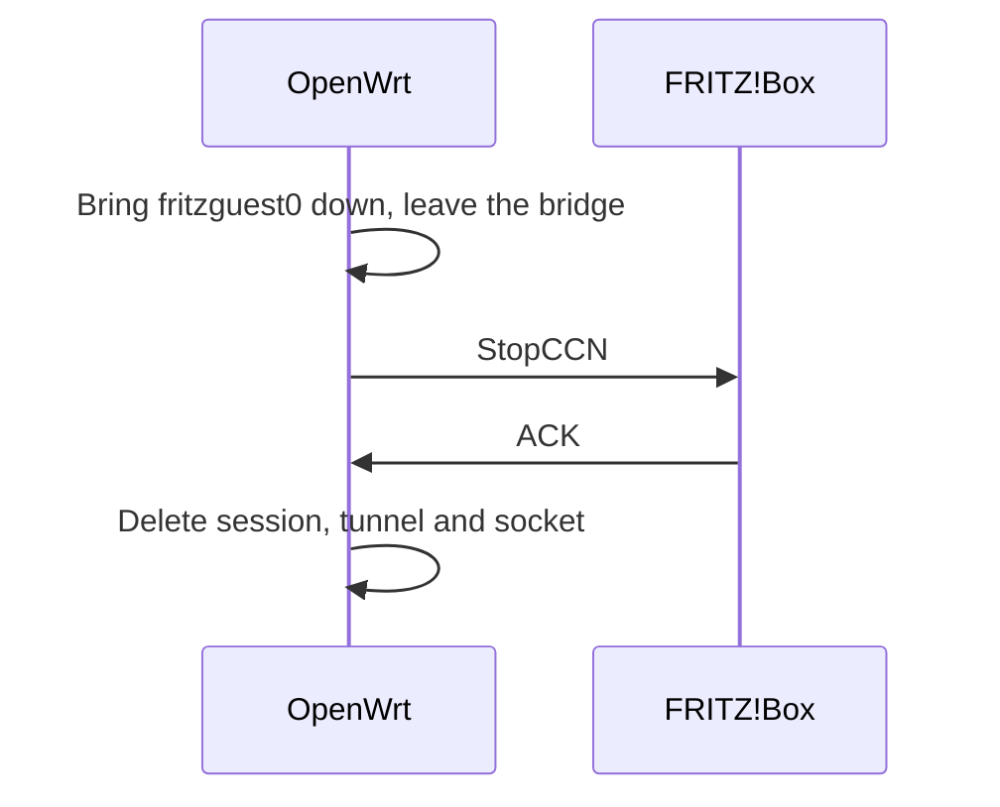

# FRITZ!Box guest transport: protocol notes

How a FRITZ!Box extends its guest network to another device over the home
LAN, and how this project talks to it. The normative behaviour of this
implementation is in [SPEC.md](../SPEC.md); this document describes the wire
protocol and the interoperability tests it is based on.

Legend: **[L]** observed in the live tests in section 7, **[I]** inferred,
**[?]** open.

## 1. Overview

A FRITZ!Box with an active guest network accepts **L2TPv3 Ethernet
pseudowires** (RFC 3931, RFC 4719) from devices on its home LAN. Each
pseudowire behaves like a virtual Ethernet cable plugged into the guest
network: the FRITZ!Box stays the guest DHCP server, gateway and Internet
policy point, and the remote device only bridges guest frames.

Two address domains must be kept apart:

* **Outer / transport network:** the home LAN, e.g. `192.168.178.0/24`. The
  tunnel endpoints use these addresses.
* **Inner / guest network:** Ethernet frames carried inside the tunnel. In the
  tests the FRITZ!Box assigned guest addresses from `192.168.179.0/24`.

| Term | Meaning |
|---|---|
| Control connection / tunnel | Stateful relationship that negotiates and maintains sessions |
| Session / pseudowire | One virtual Ethernet cable inside a control connection |
| AVP | Attribute-Value Pair, a typed field in a control message |
| Remote End ID | Service selector, here `fritz.box:guest`; not a password |
| Control plane | Setup, acknowledgements, keepalives, teardown (this daemon) |
| Data plane | Encapsulation of guest frames (Linux `l2tp_ip`/`l2tp_eth`) |



Key facts:

* Transport is **L2TPv3 directly over IP, protocol 115** (not UDP, not TCP
  port 115) **[L]**.
* Pseudowire type **Ethernet (5)**, default L2-Specific Sublayer, no cookies,
  no data sequencing **[L]**.
* The service is selected with Remote End ID **`fritz.box:guest`** **[L]**.
* No shared secret, control message authentication or mesh credentials were
  needed **[L]**.
* GRE, L2TPv2/PPP and VPN protocols are not involved.

Out of scope here: server discovery (this project uses a configured server
address), AVM Mesh membership, Wi-Fi settings synchronization.

## 2. Control plane

### 2.1 Framing

Control packets start with a zero 32-bit Session ID followed by the RFC 3931
control header (T, L, S set, version 3, Length, recipient Control Connection
ID, Ns, Nr) and AVPs. Length counts from the T bit and excludes the zero
Session ID. On Linux, a `SOCK_DGRAM`/`IPPROTO_L2TP` socket adds and strips the
zero Session ID itself (verified by `tests/kernel-test.c`).

### 2.2 Message flow

The client uses the incoming-call model:



ACKs may be explicit (message type 20) or piggybacked on the next message.
Each side chooses its own connection and session IDs; **outgoing data uses
the peer's session ID**.

### 2.3 AVPs sent by this implementation

| Message | AVPs |
|---|---|
| SCCRQ | Message Type, Host Name, Router ID, Assigned Control Connection ID, PW Capabilities List (5), Receive Window Size 1 |
| SCCCN | Message Type |
| ICRQ | Message Type, Local Session ID, Remote Session ID 0, Serial Number, PW Type 5, Remote End ID `fritz.box:guest`, Circuit Status 0x0003, L2-Specific Sublayer 1, Data Sequencing 0 |
| ICCN | Message Type, Local Session ID, Remote Session ID, Circuit Status 0x0003 |
| HELLO | Message Type |
| StopCCN | Message Type, Result Code, Assigned Control Connection ID |
| ACK | Message Type 20 (Ns is not advanced) |

This set matches what the diagnostic probe used successfully **[L]**.

### 2.4 Replies observed and validated

* **SCCRP** carried Host Name, Router ID, Assigned Control Connection ID and a
  PW Capabilities List containing Ethernet **[L]**.
* **ICRP** carried the server's Local Session ID, our session ID as Remote
  Session ID, an active Circuit Status and L2-Specific Sublayer 1 **[L]**.
  Per RFC 3931 5.4.4 an absent sublayer AVP would mean *no* sublayer, which
  this implementation rejects rather than guessing.
* A vendor-specific AVP (vendor 872, attribute 1) carrying a payload offset
  may exist; it was absent in the tests. Nonzero values are rejected **[?]**.
* Server session IDs were small sequential numbers (1001, 1002) **[L]**.

### 2.5 Teardown

CDN closes one session; StopCCN closes the connection and all its sessions.
Either side may initiate. The probe's StopCCN messages were acknowledged
**[L]**; CDN was not exercised against the live server.



Timers (1 s initial retransmission doubling up to 8 s, `retry_max`
retransmissions, `hello_interval` keepalive) are this project's defaults, not
measured FRITZ!Box values.

## 3. Data plane

```
 IPv4 header (protocol 115, home LAN addresses)
+---------------------------------------------------------------+
| Session ID (32), nonzero, the receiver's ID                   |
+---------------------------------------------------------------+
| Default L2-Specific Sublayer (32): S=0, sequence=0            |
+---------------------------------------------------------------+
| Guest Ethernet frame (dst MAC, src MAC, type, payload), no FCS|
+---------------------------------------------------------------+
```

Overhead is 20 (IPv4) + 4 + 4 + 14 = 42 bytes, so a 1500-byte guest IP packet
becomes a 1542-byte outer packet that is IPv4-fragmented on a standard LAN.
Wireshark: filter `ip.proto == 115`, L2TPv3 dissector with cookie size 0,
default L2-Specific Sublayer, Ethernet pseudowire.

Linux setup used here (generic netlink family `l2tp`):

| Object | Attributes |
|---|---|
| Tunnel | CONN_ID, PEER_CONN_ID, PROTO_VERSION 3, ENCAP_TYPE IP, FD of the control socket |
| Session | CONN_ID, SESSION_ID, PEER_SESSION_ID, PW_TYPE 5, L2SPEC_TYPE 1, IFNAME `fritzguest0` |

Because the tunnel is bound to the daemon's socket, the kernel deletes the
tunnel, session and `fritzguest0` when the socket is closed, including after a
crash (verified by `tests/kernel-test.c`).

A static `ip l2tp add tunnel/session` configuration does **not** work: the
server only creates its session after a successful SCCRQ..ICCN exchange.

## 4. Security notes

* Control messages are unauthenticated and the data is **not encrypted**. A
  host that can capture LAN traffic can read guest frames. Treat this as a
  trusted-LAN transport, not a VPN.
* `fritz.box:guest` selects a service; knowing it is not proof of identity.
* Guest-to-home filtering, guest-to-guest isolation and transport security are
  separate properties; encapsulation provides none of them.

## 5. Bridging on the client

The client attaches its session device to a dedicated guest bridge that also
holds the guest SSID and/or guest ports. That bridge must never contain the
home LAN. The FRITZ!Box remains responsible for DHCP, NAT and the guest
firewall, so the client should not run its own guest DHCP server.

## 6. Status and diagnostics

* `ubus call fritz-guest status` (state, negotiated IDs, counters)
* `ip l2tp show tunnel` / `ip l2tp show session` (needs `ip-full`)
* `logread -e fritz-guestd`; run with `--debug` for per-message traces
  (headers only, never payloads)

## 7. Interoperability tests

### 7.1 Single tunnel (2026-10-10)

`tools/fritz_guest_probe.py` is a bounded userspace test endpoint: it sends
and receives encapsulated Ethernet through a raw IP socket and creates no
interfaces or routes. Tested from OpenWrt 25.12.5 (`192.168.178.253`) to a
FRITZ!Box at `192.168.178.1` (model/firmware not recorded):

* SCCRQ/SCCRP/SCCCN and ICRQ/ICRP/ICCN succeeded with `fritz.box:guest`.
* The first 10-second observation only received spanning-tree BPDUs. With a
  45-second observation and DHCP DISCOVER retries every 10 seconds, guest ARP
  and DHCP offers from `192.168.179.1` arrived. A bridge forwarding/startup
  delay is inferred **[I]**.
* HELLO was received and acknowledged; StopCCN was acknowledged on exit.

### 7.2 Two tunnels (2026-10-10)

Two independent endpoints on the same OpenWrt device, with separate MACs,
Router IDs and control connections:

| Endpoint | Outer source IPv4 | Server Session ID | DHCP-acknowledged guest IPv4 |
|---|---|---|---|
| A | `192.168.178.253` | 1001 | `192.168.179.9` |
| B | `192.168.178.252` | 1002 | `192.168.179.7` |

* Two connections from the **same** source address both got server session
  1001 and the first stopped responding; the server appears to replace
  sessions per source address **[I]**. Distinct sources worked.
* Broadcast and unicast Ethernet, ARP and IPv4 UDP passed between A and B in
  both directions **[L]**. **Separate tunnels do not isolate guests from each
  other** on the tested configuration.
* DHCP RELEASE was sent for both leases and both StopCCNs were acknowledged.

### 7.3 What the tests establish

| Question | Result |
|---|---|
| Can a non-AVM endpoint request the service? | Yes, without credentials or secret **[L]** |
| Is every client admitted? | Not established; source restrictions and other firmware untested |
| Does guest DHCP work over the tunnel? | Yes **[L]** |
| Can clients on separate tunnels reach each other? | Yes, under the tested settings **[L]** |
| Guest-to-home isolation, Wi-Fi station reachability, Internet, IPv6, full-size packets on a real LAN | Not tested |

### 7.4 Reproducing

Use only on networks you administer. Requirements on the OpenWrt device:
Python 3, `ip-full` (JSON route output), root or `CAP_NET_RAW`, and a path
that passes IP protocol 115.

```sh
python3 tools/fritz_guest_probe.py --self-test
scp -O tools/fritz_guest_probe.py root@192.168.178.253:/tmp/probe.py
ssh root@192.168.178.253 'apk add python3 ip-full && \
    python3 /tmp/probe.py --server 192.168.178.1 --guest-network 192.168.179.0/24'
```

The default mode retries DHCP DISCOVER for 45 seconds and never accepts a
lease. Exit status `0` means success, `2` means expected traffic was not fully
observed, `1` means an error.

For the two-tunnel test, assign a second, unused LAN address temporarily
(this does not change UCI configuration):

```sh
(
  set -eu
  apk add iputils-arping
  arping -D -I br-lan -c 3 -w 5 192.168.178.252
  ip address add 192.168.178.252/32 dev br-lan
  trap 'ip address del 192.168.178.252/32 dev br-lan' EXIT
  python3 /tmp/probe.py --cross-tunnel --second-local 192.168.178.252
)
```

Cross-tunnel mode accepts two DHCP leases in userspace, installs neither,
releases both and closes both connections.

## 8. Open points

* Exact AVP sets and timers used by FRITZ!OS, and differences between models
  and firmware versions.
* Admission rules, in particular replacement of same-source connections.
* Whether guest isolation settings affect cross-tunnel forwarding.
* Meaning and use of the vendor 872 offset AVP.

## References

* [RFC 3931 - L2TPv3](https://www.rfc-editor.org/rfc/rfc3931.html)
* [RFC 4719 - Ethernet over L2TPv3](https://www.rfc-editor.org/rfc/rfc4719.html)
* [Linux L2TP documentation](https://docs.kernel.org/networking/l2tp.html)
* [OpenWrt L2TP kernel modules](https://github.com/openwrt/openwrt/blob/main/package/kernel/linux/modules/netsupport.mk)
